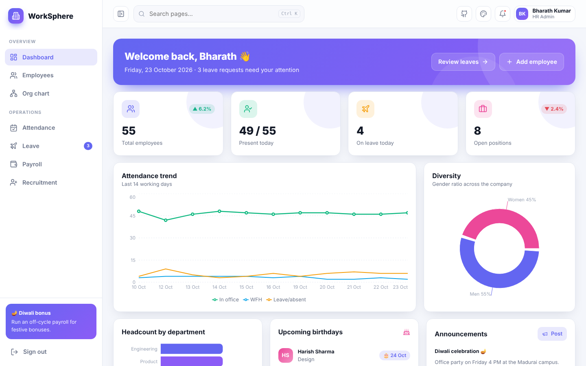
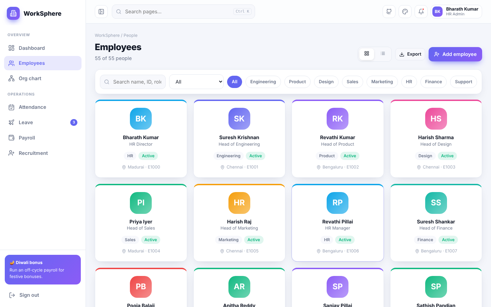
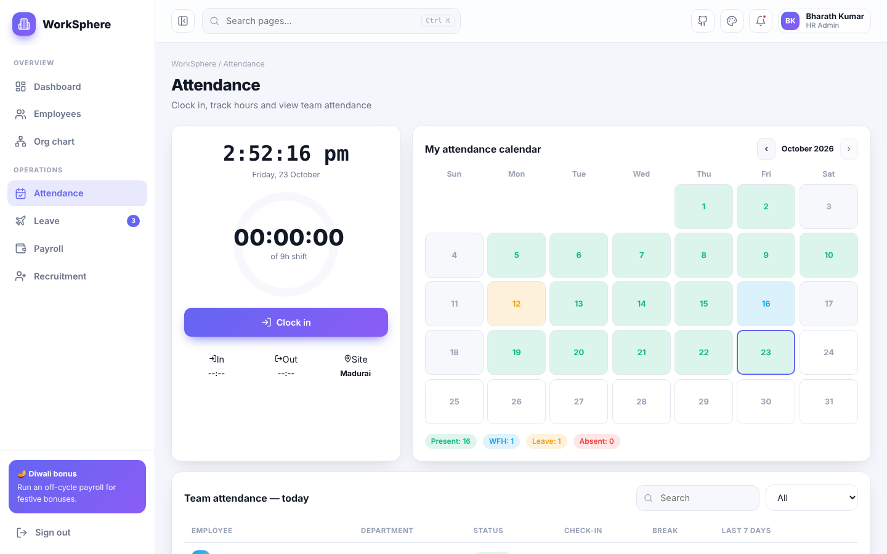
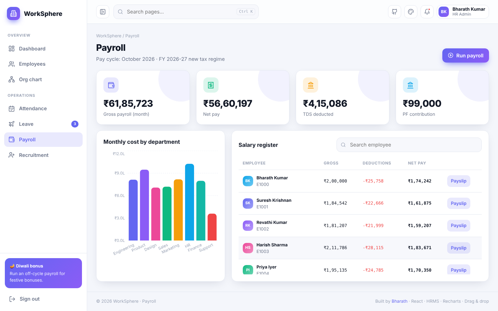
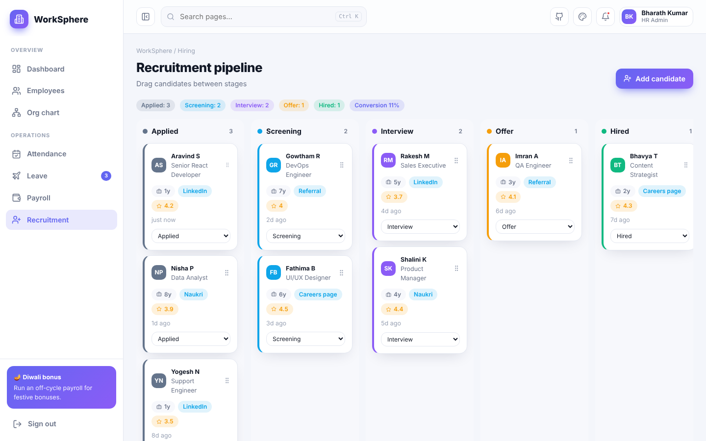
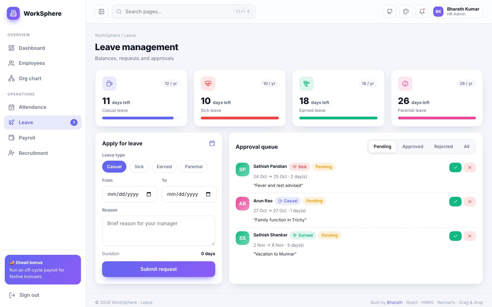

<div align="center">

# 🏢 WorkSphere — HRMS Portal

**A complete Human Resource Management System in React — employees, attendance with live clock-in, leave approvals, Indian payroll with payslips, a drag-and-drop hiring pipeline, an interactive org chart and people analytics.**

[](https://preciousbharath.github.io/WORKSPHERE-HRMS-PORTAL/)


### 🔗 [preciousbharath.github.io/WORKSPHERE-HRMS-PORTAL](https://preciousbharath.github.io/WORKSPHERE-HRMS-PORTAL/)
Demo login → **demo@worksphere.app** / **Demo@1234**

</div>

---

## ✨ Modules

| Module | What you can do |
|---|---|
| 🔐 **Auth** | Register/login with roles (HR Admin, Manager, Employee, Recruiter, Finance), strength meter, hashed passwords, demo account |
| 📊 **Dashboard** | Headcount, present today, on-leave, open roles; attendance trend, diversity donut, headcount by department, birthdays, top performers, announcements you can publish |
| 👥 **Employees** | 55 seeded employees, grid ⇄ table views, search, department & status filters, profile modal, add/edit with validation, offboard, CSV export |
| 🕘 **Attendance** | Live clock, clock-in/out with a 9-hour shift ring, monthly attendance calendar (Present/WFH/Leave/Absent), team status table with 7-day history |
| 🌴 **Leave** | Balances for Casual/Sick/Earned/Parental, apply with date-range & balance checks, approval queue with approve/reject |
| 💰 **Payroll** | Indian salary structure (Basic 50%, HRA 40% of basic, special allowance), PF, professional tax, new-regime TDS; department cost chart, salary register, printable payslips, animated payroll run |
| 🧲 **Recruitment** | Kanban pipeline (Applied → Screening → Interview → Offer → Hired) with HTML5 drag & drop, scores, sources, conversion rate, add candidate |
| 🌳 **Org chart** | Collapsible reporting tree with department colour coding |
| 🎨 **UX** | 5 themes, 6 accents, animations toggle, toasts, Ctrl+K page search, responsive sidebar |

## 🖼️ Screenshots

| Dashboard | Employees |
|---|---|
|  |  |
| **Attendance** | **Payroll** |
|  |  |
| **Recruitment** | **Leave** |
|  |  |

## 🛠️ Tech

React 18 · Vite 5 · React Router · Recharts · lucide-react · HTML5 Drag & Drop · CSS variables theming · localStorage persistence · GitHub Pages

## 🚀 Run locally

```bash
git clone https://github.com/PreciousBharath/WORKSPHERE-HRMS-PORTAL.git
cd WORKSPHERE-HRMS-PORTAL
npm install && npm run dev
```

## 📁 Structure

```
src/
├── core/          # auth, themes, layout, UI kit, settings
├── lib/hr.jsx     # seeded org data, attendance model, payroll calculator, state actions
└── pages/         # Dashboard, Employees, Attendance, Leave, Payroll, Recruitment, OrgChart
```

> Payroll maths is illustrative for learning purposes — consult a payroll professional for statutory compliance.

## 👨‍💻 Author

**Bharath** — Software Developer · Project Engineer · Technical Trainer · Madurai  
[GitHub](https://github.com/PreciousBharath) · [LinkedIn](https://linkedin.com/in/connectbharath) · [Portfolio](https://itsbharathportfolio.netlify.app)
